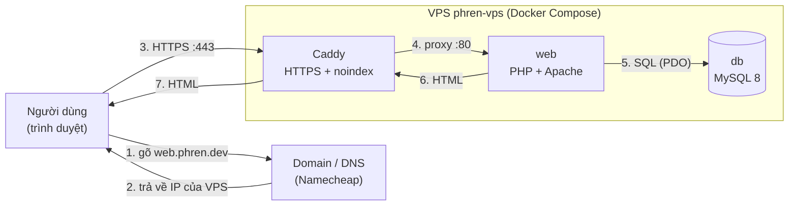
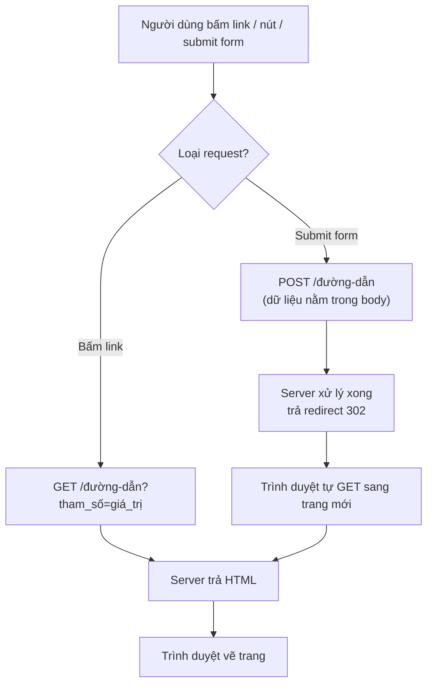
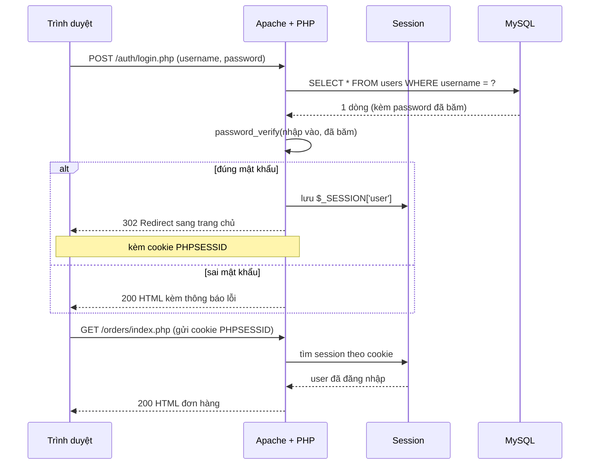
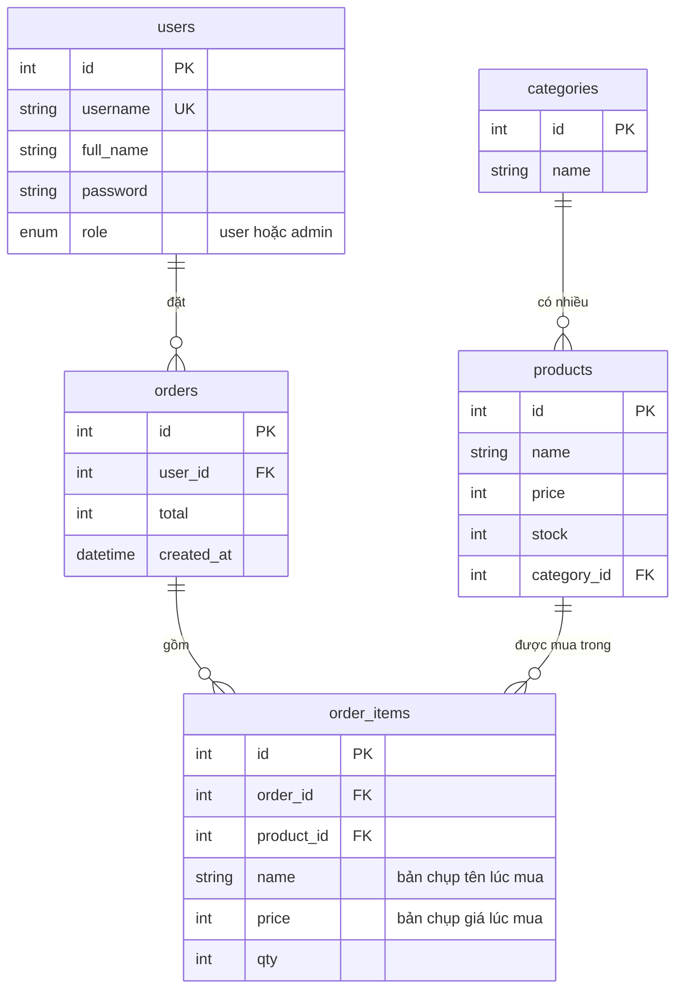
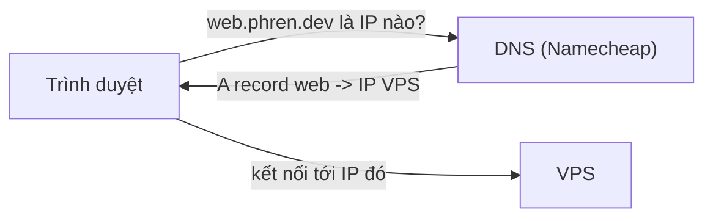
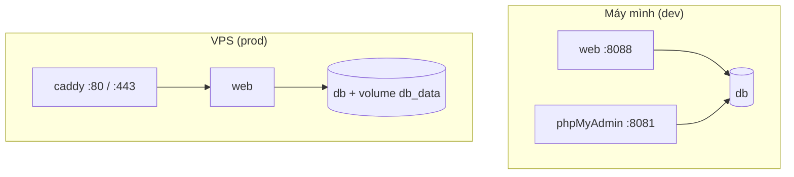
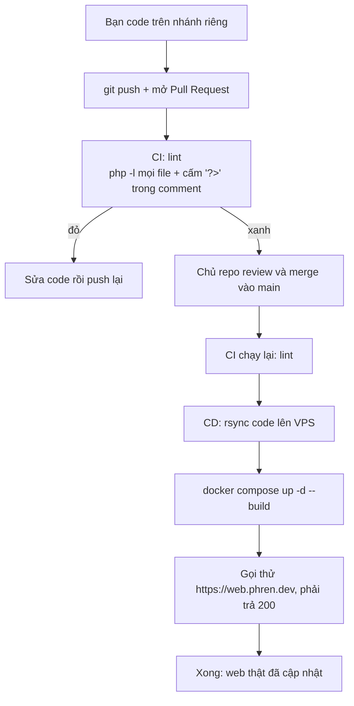
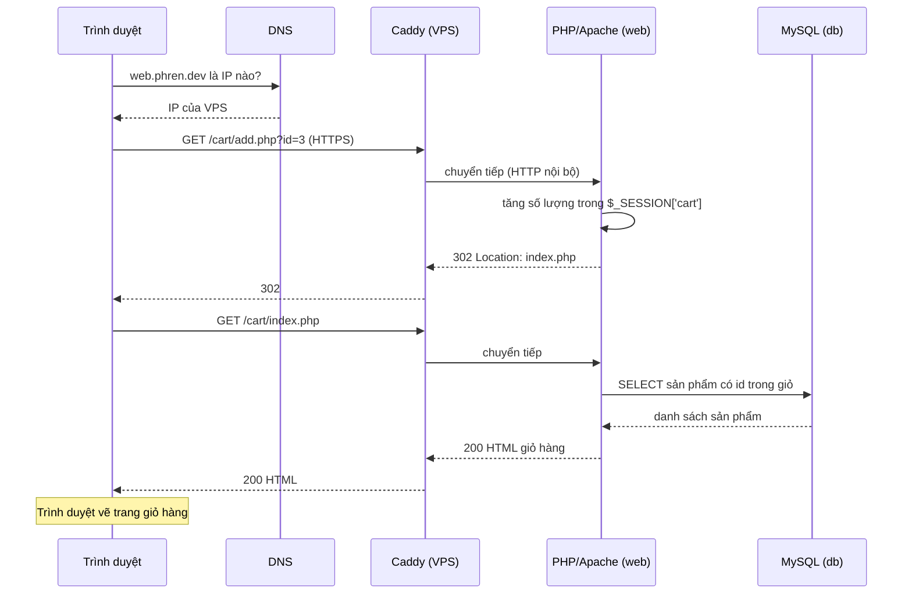

# Kiến trúc & luồng hoạt động

Tài liệu này giải thích web LaptopShop chạy như thế nào, từ lúc người dùng gõ địa chỉ cho tới lúc code của tụi mình lên được server thật. Đọc theo thứ tự từ trên xuống.

> GitHub tự vẽ các sơ đồ Mermaid bên dưới. Nếu xem trong editor mà thấy chữ code thì mở file này trên GitHub.

---

## 0. Bức tranh tổng thể



Tóm tắt: trình duyệt hỏi DNS để biết IP, gọi tới Caddy, Caddy chuyển cho PHP, PHP hỏi MySQL, rồi HTML trả ngược lại.

---

## 1. Client (trình duyệt)

**Định nghĩa:** phía người dùng nhìn và bấm. Trình duyệt nhận HTML do server trả về rồi vẽ ra màn hình.

**Ở project này:** không có React hay Next.js. Server (PHP) tạo sẵn HTML hoàn chỉnh rồi gửi xuống. Giao diện dùng Tailwind CDN, chỉ là class CSS trong HTML.



Ví dụ form đăng nhập (`src/auth/login.php`):

```html
<form method="post">
  <input name="username" />
  <input name="password" type="password" />
  <button>Đăng nhập</button>
</form>
```

`name="..."` của mỗi ô chính là tên khoá mà PHP đọc bằng `$_POST['username']`.

---

## 2. API contract (hợp đồng giữa client và server)

**Định nghĩa:** danh sách quy ước "gọi đường dẫn nào, bằng method nào, gửi tham số gì, nhận lại gì". Hai bên (HTML phía client, PHP phía server) phải thống nhất đúng tên.

**Ở project này:** KHÔNG có API trả JSON. Mỗi file `.php` là một "endpoint" nhận form / query string và trả về HTML hoặc redirect. Các endpoint chính:

| Method | Đường dẫn | Tham số | Kết quả |
|---|---|---|---|
| GET | `/index.php` | `q` (tìm kiếm), `cat` (id danh mục), cả hai không bắt buộc | HTML danh sách sản phẩm |
| POST | `/auth/login.php` | `username`, `password` | thành công: redirect `/admin/index.php` (admin) hoặc `/index.php` (user). Sai: hiện lỗi |
| POST | `/auth/register.php` | `username`, `password`, `confirm`, `full_name` (không bắt buộc) | thành công: redirect `login.php` |
| GET | `/auth/logout.php` | không | xoá session, redirect `/index.php` |
| GET | `/cart/add.php` | `id` (id sản phẩm) | thêm vào giỏ, redirect `cart/index.php` |
| POST | `/cart/update.php` | `qty` (mảng số lượng theo từng sản phẩm) | cập nhật giỏ, redirect về giỏ |
| GET | `/cart/remove.php` | `id` | xoá khỏi giỏ, redirect về giỏ |
| POST | `/cart/checkout.php` | không (lấy giỏ từ session) | tạo đơn, redirect `/orders/index.php`. Giỏ rỗng: về giỏ |
| GET | `/orders/index.php` | không (cần đăng nhập) | HTML đơn hàng của tôi |
| GET | `/admin/index.php`, `/admin/orders/index.php` | không (cần admin) | HTML trang quản trị / mọi đơn hàng |
| GET, POST | `/admin/products/create.php` | `name`, `price`, `stock`, `description`, `image`, `category_id` | thành công: redirect danh sách |
| GET, POST | `/admin/products/edit.php?id=` | giống create | thành công: redirect danh sách |
| GET | `/admin/products/delete.php?id=` | `id` | xoá, redirect danh sách |
| GET, POST | `/admin/categories/create.php` | `name` | redirect danh sách |
| GET, POST | `/admin/categories/edit.php?id=` | `name` | redirect danh sách |
| GET | `/admin/categories/delete.php?id=` | `id` | xoá, redirect danh sách |

Quy tắc chung: chưa đăng nhập mà vào trang cần quyền thì bị đẩy về `/auth/login.php`. Trang `/admin/*` yêu cầu `role = admin`.

Ví dụ một endpoint đọc tham số và trả redirect (`cart/add.php` rút gọn):

```php
<?php
require_once __DIR__ . '/../config/db.php';

$id = (int)($_GET['id'] ?? 0);               // đọc ?id=... trên URL
$_SESSION['cart'][$id] = ($_SESSION['cart'][$id] ?? 0) + 1;

header('Location: index.php');               // báo trình duyệt chuyển trang
exit;                                        // luôn exit sau redirect
```

---

## 3. Server (PHP + Apache)

**Định nghĩa:** chương trình chạy trên máy chủ, nhận request, xử lý logic, hỏi database, trả response.

**Ở project này:** Apache nhận request, thấy đường dẫn `/cart/add.php` thì chạy file `src/cart/add.php`. Đây gọi là routing theo file: đường dẫn URL khớp đúng đường dẫn thư mục.



Các khái niệm hay gặp:

- **Session** (`$_SESSION`): bộ nhớ riêng của từng người dùng trên server, trình duyệt chỉ giữ cái cookie `PHPSESSID` làm chìa khoá. Giỏ hàng và thông tin đăng nhập nằm ở đây.
- **PDO prepared statement:** truyền tham số riêng khỏi câu SQL để không bị SQL injection.
- **`e()`:** hàm bọc `htmlspecialchars`, luôn dùng khi in dữ liệu người dùng ra HTML để không bị XSS.
- **`password_hash` / `password_verify`:** DB chỉ lưu mật khẩu đã băm, không bao giờ lưu mật khẩu thật.

Ví dụ truy vấn an toàn + in an toàn:

```php
$stmt = $pdo->prepare('SELECT * FROM products WHERE name LIKE ?');
$stmt->execute(['%' . $_GET['q'] . '%']);     // tham số đi riêng, không nối chuỗi
foreach ($stmt->fetchAll() as $p) {
    echo '<h3>' . e($p['name']) . '</h3>';     // e() để chống XSS
}
```

---

## 4. Database (MySQL)

**Định nghĩa:** nơi lưu dữ liệu lâu dài (tắt server vẫn còn). PHP nói chuyện với nó bằng SQL.



Lưu ý: `order_items` chụp lại tên và giá lúc mua để sau này sửa giá sản phẩm thì đơn cũ không bị đổi.

File `db/init.sql` chỉ chạy lần đầu khi volume DB còn trống. Sửa schema khi DB đã chạy thì phải dùng `ALTER TABLE`, không sửa `init.sql` rồi mong nó tự cập nhật.

---

## 5. Domain & DNS

**Định nghĩa:** domain là tên dễ nhớ (`web.phren.dev`). DNS là "danh bạ" đổi tên đó thành địa chỉ IP của máy chủ.



Ở project này chỉ có một A record `web` trỏ về IP VPS. Domain gốc `phren.dev` là site khác, không bị ảnh hưởng.

Ví dụ A record trong Namecheap:

```text
Type: A    Host: web    Value: <IP của VPS>
```

---

## 6. VPS

**Định nghĩa:** máy chủ ảo thuê trên mạng, chạy 24/7, có IP công khai. Mình SSH vào để điều khiển.

Trên VPS này code nằm ở `/opt/web-phren`, mọi thứ chạy bằng Docker Compose. Chỉ có cổng 80 và 443 mở ra ngoài, MySQL không mở cổng, nên người ngoài không kết nối thẳng vào DB được.

---

## 7. Docker

**Định nghĩa:** đóng gói app cùng môi trường chạy của nó vào "container", để máy nào chạy cũng giống nhau. Docker Compose khai báo nhiều container chạy cùng nhau trong một file YAML.

Có hai file Compose cho hai môi trường:

| | Máy mình (dev) | VPS (prod) |
|---|---|---|
| File | `docker-compose.yml` | `docker-compose.prod.yml` |
| Code PHP | mount thư mục `src`, sửa là thấy ngay | copy vào image lúc build |
| Cổng web | `localhost:8088` | qua Caddy, cổng 80/443 |
| phpMyAdmin | có, `localhost:8081` | không có |
| Mật khẩu DB | `root` / `root` | ngẫu nhiên trong file `.env` trên VPS |



Lệnh hay dùng khi dev:

```bash
docker compose up -d --build    # chạy (và build lại nếu đổi Dockerfile)
docker compose logs -f web      # xem log PHP
docker compose down             # tắt
docker compose down -v          # tắt và XOÁ dữ liệu DB (để init.sql chạy lại)
```

---

## 8. Caddy (reverse proxy)

**Định nghĩa:** reverse proxy là người gác cổng đứng trước app, nhận request từ ngoài rồi chuyển vào trong. Caddy còn tự xin và gia hạn chứng chỉ HTTPS miễn phí.

Ở project này Caddy làm ba việc: lấy HTTPS cho `web.phren.dev`, gắn header chống Google index, và chuyển request sang container `web`.

```text
web.phren.dev {
    header X-Robots-Tag "noindex, nofollow, noarchive, nosnippet"
    reverse_proxy web:80
}
```

`web:80` là tên container trong mạng Docker, Docker tự phân giải tên này thành IP nội bộ.

---

## 9. Từ code đến server thật (Git + CI/CD)

**Định nghĩa:** CI (kiểm tra code tự động) và CD (tự đưa lên server). Ở đây dùng GitHub Actions: file `.github/workflows/deploy.yml`.



Quy trình làm việc của mỗi người:

```bash
git switch -c ten-chuc-nang      # tạo nhánh riêng, không code trên main
# ...sửa code...
git add .
git commit -m "Mô tả ngắn việc đã làm"
git pull --rebase origin main    # kéo code mới về TRƯỚC khi push, tránh conflict
git push -u origin ten-chuc-nang
# rồi lên GitHub mở Pull Request
```

Điều quan trọng: **push vào `main` là tự deploy lên web thật.** Vì vậy luôn làm trên nhánh riêng và qua Pull Request. Đừng bao giờ commit mật khẩu, file `.env` hay dữ liệu thật vào repo (repo này public).

Bí mật dùng để deploy (SSH key, IP VPS) nằm trong GitHub Secrets, không nằm trong code.

---

## 10. Tổng hợp một request đầy đủ

Ví dụ: khách bấm "Thêm vào giỏ" ở trang chủ.



---

## Bảng thuật ngữ nhanh

| Từ | Nghĩa ngắn |
|---|---|
| Client | Trình duyệt của người dùng |
| Server | Chương trình PHP/Apache xử lý request |
| Endpoint | Một đường dẫn xử lý được, ở đây là một file `.php` |
| GET / POST | GET để lấy trang (tham số trên URL). POST để gửi dữ liệu (tham số trong body) |
| Redirect (302) | Server bảo trình duyệt "đi sang trang khác" |
| Session | Bộ nhớ riêng của mỗi người dùng trên server, nhận diện bằng cookie |
| Reverse proxy | Cổng trước, nhận request ngoài rồi chuyển vào app |
| Container | Hộp đóng gói app + môi trường chạy |
| Volume | Ổ lưu dữ liệu của container, tắt container vẫn còn |
| DNS / A record | Danh bạ đổi tên miền ra IP |
| CI / CD | Tự kiểm tra code / tự đưa code lên server |
